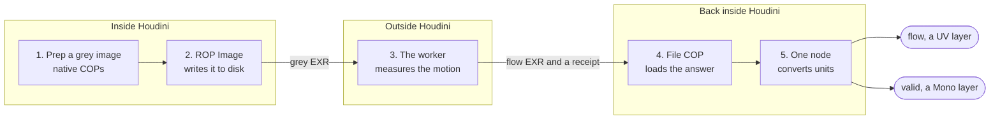
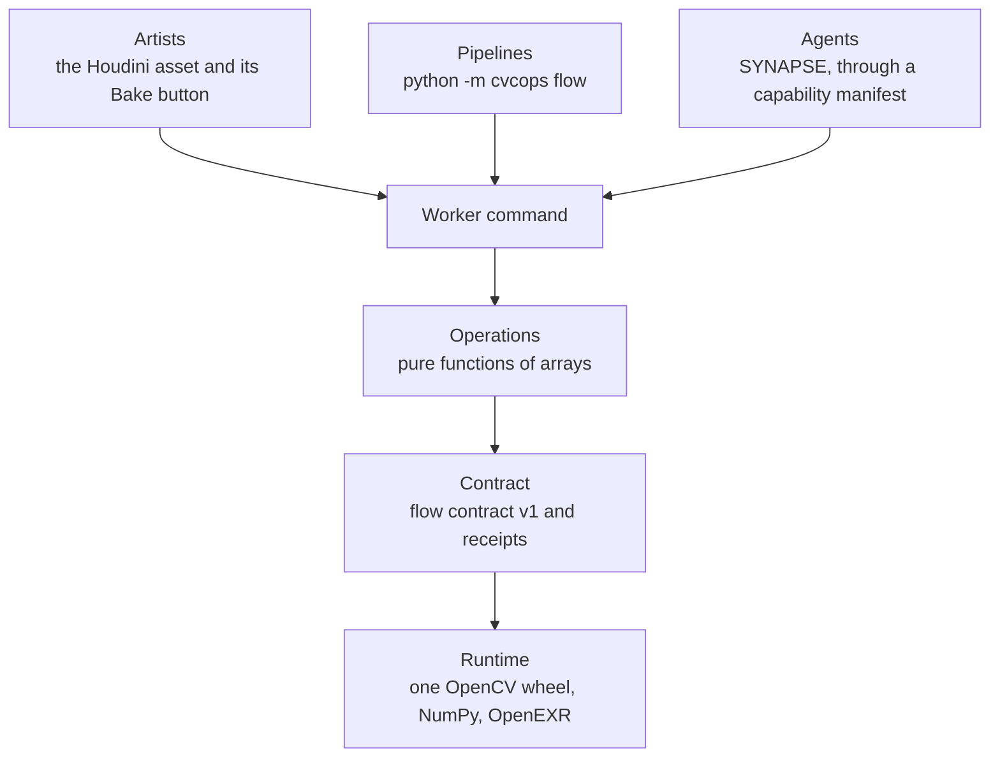
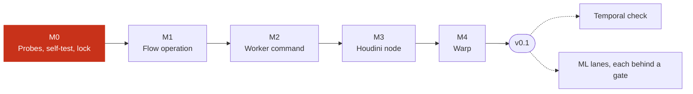

<p align="center">
  <picture>
    <source media="(prefers-color-scheme: dark)" srcset="docs/media/logo-dark.svg">
    
  </picture>
</p>

<p align="center"><b>CVCOPs teaches Houdini's Copernicus to see motion, and to say when it is not sure.</b></p>

---

## What it is

CVCOPs gives Copernicus optical flow for footage that was never rendered.

For every pixel in a frame, it answers two questions. The first is where that pixel went in the next frame. The second is whether to trust that answer.

**You get two layers back: `flow` and `valid`.** If you have lit a shot, `flow` is the same kind of layer as a motion-vector pass. The one difference is that it is an estimate, so it carries its own trust mask.

<p align="center">
  <a href="https://github.com/JosephOIbrahim/CVCOPS/releases/download/v0.0.0/CVCOPs_explainer.mp4">
    
  </a>
</p>
<p align="center"><sub>A silent preview. <a href="https://github.com/JosephOIbrahim/CVCOPS/releases/download/v0.0.0/CVCOPs_explainer.mp4">Watch the full explainer</a>: 3 minutes, 1080p, with sound, from the <a href="https://github.com/JosephOIbrahim/CVCOPS/releases/tag/v0.0.0">v0.0.0 pre-release</a>.</sub></p>

## Where it stands

**This is a pre-release. The Houdini node is not built yet.** What exists today is the contract, the tests that will judge the build, and proof that those tests work.

| Part | State on 10 November 2026 |
| --- | --- |
| The judge: threshold tests and `tools/check.py` | Built. Its self-test passes the reference on every row and catches all nine planted faults, on Linux and on Windows. |
| Mission 0: probes on a real workstation | Recorded. Frames cross Houdini's File COP and ROP Image bit for bit. One step is open: the owner's lock. |
| The flow operation and the worker command | Not built. Missions 1 and 2. |
| The Houdini asset, `cvcops::flow::1.0` | Not built. Mission 3. Its 14 parameters are specified in `houdini/build/controls.json`, and a dry run builds them all in Houdini 22. |
| The warp example | Not built. Mission 4. |
| A licence | None. There is no `LICENSE` file, the same as MotionCOPs, so default copyright applies. Ask before reusing the code. |

The live record is [`docs/STATE.md`](docs/STATE.md). It is updated at the end of every working session.

The [v0.0.0 pre-release](https://github.com/JosephOIbrahim/CVCOPS/releases/tag/v0.0.0) marks this point. It carries the explainer video and no installable node.

## How a bake works

**Each frame takes five steps, with one small file crossing each way.**



The worker runs in its own Python environment, on one stock OpenCV wheel. Nothing is installed into Houdini's Python.

Every flow file comes with a receipt. The receipt records what ran, on which backend, with which settings, so a cached frame can be checked instead of trusted.

## One engine, three ways in

**Artists, pipelines and agents all reach the same engine the same way: files in, files out.**



The engine in `src/cvcops` never imports Houdini. The Houdini side never imports OpenCV. Two guard tests hold that line.

CVCOPs is planned to become the perception engine for SYNAPSE. SYNAPSE will depend on it, and never the other way round.

## How it gets built

**It is built one mission at a time, against tests the builder cannot loosen.**



Claude Code does the building, one mission per session. The thresholds were measured first, written as tests, and are locked by the owner before each mission starts.

A mission is done when one command exits 0. Nothing the mission writes can change what that command measures.


## Measured so far

**Every number below comes from a script in `evidence/`, and each has an entry in [`docs/FACTS.md`](docs/FACTS.md).**

| What was measured | Result | Where |
| --- | --- | --- |
| Flow error on a two-region test, 1080p, full analysis scale | 0.037 px | FACTS M11 |
| Half analysis scale | 3.3 to 3.4 times faster, for about 0.08 px more error | FACTS M18 |
| Good pixels wrongly flagged as untrusted, 1,000 test pairs | 0.14% on average | FACTS M14 |
| Occlusions of 12 to 16 px caught by the trust mask | 0.94 (median) | FACTS M14 |
| One 1080p pair on the CPU, workstation, 48 threads | 76 ms | FACTS P6 |
| Transport through File COP and ROP Image | Bit-exact at 32-bit float | FACTS P3 |

These are reference numbers on synthetic test frames. They are the bar the build has to clear, and they say nothing yet about production plates.

## After the first release

Seventeen uses sit on the same two layers. **The temporal check comes first**: pull each frame onto its neighbour, measure what is left over, and rank the frames that stand out.

| Read | For |
| --- | --- |
| [`docs/OPPORTUNITIES.md`](docs/OPPORTUNITIES.md) | All seventeen uses, and why the temporal check is first |
| [`docs/ML_AND_AI.md`](docs/ML_AND_AI.md) | Where machine learning comes in: a mask from Houdini's own models, then learned flow, each held to the same tests |
| [`docs/CONTROLS.md`](docs/CONTROLS.md) | The node's inputs, outputs and parameters |

None of that is built. Each item waits for v0.1, and each ML lane waits for a probe.

## Try the judge today

You can run the tests that will judge the build, without Houdini. You need [`uv`](https://docs.astral.sh/uv/); it fetches Python 3.13 and the pinned packages.

```bash
uv sync
uv run python tools/check.py --selftest
uv run python evidence/opportunities_reference.py
```

The first command builds the worker's environment. The second proves the judge: the reference passes every row, and nine planted faults each fail. The third runs three small demonstrations of uses that come after v0.1.

Plain `uv run python tools/check.py` fails until `judge.lock` exists. That is by design.

## Repository map

| Path | What it holds |
| --- | --- |
| [`docs/BLUEPRINT.md`](docs/BLUEPRINT.md) | What gets built, in which missions, against which thresholds |
| [`docs/ARCHITECTURE.md`](docs/ARCHITECTURE.md) | Where each part lives and what may talk to what |
| [`docs/FACTS.md`](docs/FACTS.md) | Every verified fact, measurement and open assumption, with its source |
| [`docs/STATE.md`](docs/STATE.md) | Where things stand and the next action |
| [`docs/decisions/`](docs/decisions/) | The decisions made so far, each with its reason |
| `src/cvcops/` | The engine: the contract, the operations, the worker command |
| `tests/thresholds/` | The locked tests, one per threshold |
| `tools/check.py` | The judge's front door |
| `houdini/` | The asset's builder, its parameter spec and its tests |
| `evidence/` | The scripts behind every number |
| [`GOALS.md`](GOALS.md), [`CLAUDE.md`](CLAUDE.md) | How Claude Code works in this repository |
| [`docs/SETUP.md`](docs/SETUP.md) | First-session steps for a new checkout |

## Credits

CVCOPs was planned beside [MotionCOPs](https://github.com/Boning1011/motion-cops) by Boning1011, a motion toolkit for Copernicus. MotionCOPs is not bundled in this repository.

The logo is one image tile holding a small field of motion arrows. One cell is a dot instead: the pixel it is not sure about.
