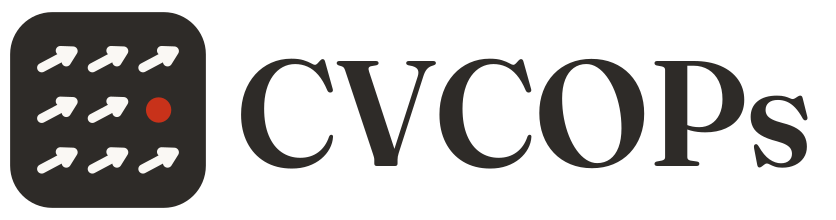
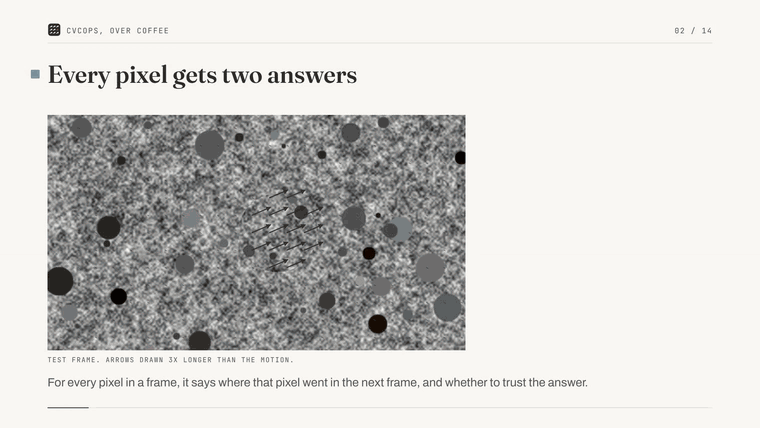
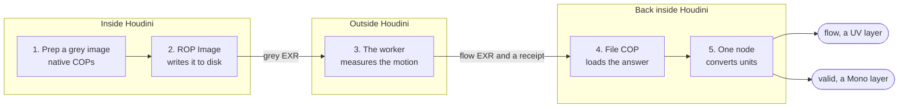
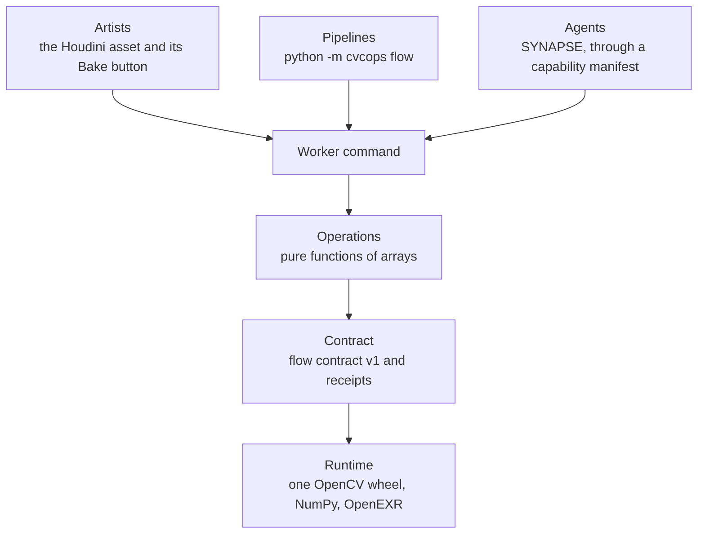
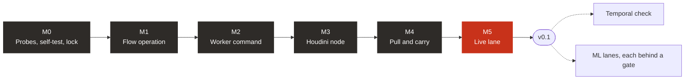
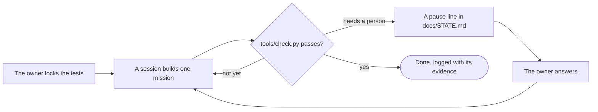
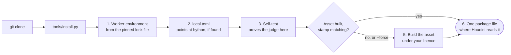

<p align="center">
  <picture>
    <source media="(prefers-color-scheme: dark)" srcset="docs/media/logo-dark.svg">
    
  </picture>
</p>

<p align="center"><b>CVCOPs teaches Houdini's Copernicus to see motion, and to say when it is not sure.</b></p>

---

## What it is

CVCOPs gives Copernicus optical flow for footage that was never rendered.

For every pixel in a frame, it answers two questions. The first is where that pixel went in the next frame. The second is whether to trust that answer.

**You get two layers back: `flow` and `valid`.** If you have lit a shot, `flow` is the same kind of layer as a motion-vector pass. The one difference is that it is an estimate, so it carries its own trust mask.

<p align="center">
  <a href="https://github.com/JosephOIbrahim/CVCOPS/releases/download/v0.0.0/CVCOPs_explainer.mp4">
    
  </a>
</p>
<p align="center"><sub>A silent preview. <a href="https://github.com/JosephOIbrahim/CVCOPS/releases/download/v0.0.0/CVCOPs_explainer.mp4">Watch the full explainer</a>: 3 minutes, 1080p, with sound, from the <a href="https://github.com/JosephOIbrahim/CVCOPS/releases/tag/v0.0.0">v0.0.0 pre-release</a>.</sub></p>

## Where it stands

**v0.1 is being finished, not released.** The judge, the worker and the Houdini asset are built and proven, and the
release gate is open. One mission is left before it: the live lane.

| Part | State on 12 November 2026 |
| --- | --- |
| The judge: threshold tests and `tools/check.py` | Built and locked. Its self-test passes the reference on every row and catches all nine planted faults; rung 2 passes three rows through the asset |
| Mission 0: probes on a real workstation | Done. Frames cross Houdini's File COP and ROP Image bit for bit |
| M1 to M4: the flow operation, the worker command, the Houdini asset and the pull | Done and closed. `two_region` reads 0.037 px at analysis scale 1.0 and 0.115 px at 0.5; the pull reads 1.0023 levels against a 1.5 limit |
| The example: a two-region plate, a carry, a look | Done. A painted mark carried eight frames back from a key frame tracks the plate to 0.33 px |
| M5, the live lane | Not built. The brief is adopted and starts after M4 |
| The installer, `tools/install.py` | Built. It sets up the worker, writes `local.toml`, runs the self-test, builds the asset under your own licence, and writes one package file |
| A licence | None. There is no `LICENSE` file, the same as MotionCOPs, so default copyright applies |

## How a bake works

**Each frame takes five steps, with one small file crossing each way.**



The worker runs in its own Python environment, on one OpenCV wheel: `opencv-contrib-python-headless`, pinned in `uv.lock`. Nothing is installed into Houdini's Python.

Every flow file comes with a receipt. The receipt records what ran, on which backend, with which settings, so a cached frame can be checked instead of trusted.

## One engine, three ways in

**Artists, pipelines and agents all reach the same engine the same way: files in, files out.**



The engine in `src/cvcops` never imports Houdini. The Houdini side never imports OpenCV. Two guard tests hold that line.

CVCOPs is planned to become the perception engine for SYNAPSE. SYNAPSE will depend on it, and never the other way round.

## How it gets built

**It is built one mission at a time, against tests the builder cannot loosen.**



Claude Code does the building, one mission per session. The thresholds were measured first, written as tests, and are locked by the owner before each mission starts.

A mission is done when one command exits 0. Nothing the mission writes can change what that command measures.



## Measured so far

**Every number below comes from a script in `evidence/` or `probes/`, and each has an entry in [`docs/FACTS.md`](docs/FACTS.md). The release's own plate numbers came from the owner running the same commands on his machine, and FACTS says so.**

| What was measured | Result | Where |
| --- | --- | --- |
| Flow error on a two-region test, 1080p, full analysis scale | 0.037 px | FACTS M11 |
| Half analysis scale | 3.3 to 3.4 times faster, for about 0.08 px more error | FACTS M18 |
| Good pixels wrongly flagged as untrusted, 1,000 test pairs | 0.14% on average | FACTS M14 |
| Occlusions of 12 to 16 px caught by the trust mask | 0.94 (median) | FACTS M14 |
| One 1080p pair on the CPU, workstation, 48 threads | 76 ms | FACTS P6 |
| Transport through File COP and ROP Image | Bit-exact at 32-bit float | FACTS P3 |

These are reference numbers on synthetic test frames. They are the bar the build has to clear, and they say nothing yet about production plates.

## After the first release

Seventeen uses sit on the same two layers. **The temporal check comes first**: pull each frame onto its neighbour, measure what is left over, and rank the frames that stand out.

| Read | For |
| --- | --- |
| [`docs/OPPORTUNITIES.md`](docs/OPPORTUNITIES.md) | All seventeen uses, and why the temporal check is first |
| [`docs/ML_AND_AI.md`](docs/ML_AND_AI.md) | Where machine learning comes in: a mask from Houdini's own models, then learned flow, each held to the same tests |
| [`docs/CONTROLS.md`](docs/CONTROLS.md) | The node's inputs, outputs and parameters |

None of that is built. Each item waits for v0.1, and each ML lane waits for a probe.

## Limits, and where each one is recorded

Every line here is a measured limit, not a caveat. The evidence is in [`docs/FACTS.md`](docs/FACTS.md).

| Limit | Why | Evidence |
| --- | --- | --- |
| **CPU only in v0.1.** `opencl` and `cuda` are refused before any work | no v0.1 recipe is graded on a GPU; the refusal writes nothing | decision 0004(d); `docs/STATE.md`'s DEC.quarter line; the receipt's `backend` field |
| **Forward flow only.** A fix travels to earlier frames, never later ones | the cache holds flow from A to B; there is no backward pair | M4's carry example, FACTS H40 |
| **Validity is a flag, not a mask.** It misses narrow occlusions | forward-backward agreement fails on thin occluders | FACTS M12 to M14 |
| **DIS patch size at most 16 px** before OpenCV 5.1 | the OpenCV release notes; larger patches misbehave | `CLAUDE.md`, gotchas |
| **Flow loads at 32-bit.** Half float rounds large motions | a half-float layer moves a 512 to 1024 px motion by up to 0.25 px | FACTS M17 |
| **8-bit analysis needs Gain and Gamma** on scene-linear plates | scene-linear frames clip when quantised to 8 bits | FACTS M15; the receipt warns above 5% clipped or under 32 grey levels |
| **Frame sizes must match** between the two frames of a pair | the worker pairs equal-sized images | `src/cvcops/ops/flow.py` |
| **The Frame Range default stops one frame early** | the export needs a successor frame for the last pair | OD-28; `docs/CONTROLS.md` |
| **Distort is the pull.** Pixels per Step off matches `cv2.remap`; on drifts | measured on twelve pairs and a 149 px field | FACTS H38 |
| **An asset built under Indie is limited commercial**, so `install.py` builds it under your own licence | SideFX's licence terms; no `.hda` ships | FACTS P7; decision 0005 |
| **A carried fix left of 1016 in the example shows the 1016 mark** | the Switch clamps at the first carried step | M4's close entry |
| **Windows 11 and Houdini 22.0.492** are what is tested | the synthetic rows were first measured on a 2-thread Linux sandbox (M14, M15, M17; FACTS says which) and re-measured here; the plate and the asset rows came from this workstation | FACTS P1, and each row's own line |
| **Thresholds come from synthetic frames plus one owner plate** | the locked rows are synthetic; the plate is evidence, not a row | `tests/thresholds/`, `docs/facts/rel_plate_summary.json` |
| **No licence file.** Default copyright applies | Joe's decision at the release plan | OD-29; decision 0005 |

Where this table and the running build disagree, the build wins and `docs/FACTS.md` is corrected.

## Install

**One command sets up everything that exists today.** You need `git` and [`uv`](https://docs.astral.sh/uv/). `uv` fetches Python 3.13 and the pinned packages for you.

```bash
git clone https://github.com/JosephOIbrahim/CVCOPS.git
cd CVCOPS
uv run python tools/install.py
```



The installer is safe to run again. It only fills in what is missing.

| It does | It never does |
| --- | --- |
| Build the worker's environment in `.venv` | Install anything into Houdini's Python |
| Find the newest Houdini and write `local.toml` | Overwrite a `local.toml` you already have |
| Run the judge's self-test, about 40 seconds | Change a system setting or ask for administrator rights |
| Build the asset under your licence when it is missing or its stamp differs | Commit or ship a built `.hda` |
| Write one package file, and print its path for you to confirm | Install anything into Houdini's Python |

To see what it would do without changing anything, add `--check`. Other options are `--hython PATH`, `--no-houdini` and `--no-selftest`.

You can also download `install.py` alone from the [latest pre-release](https://github.com/JosephOIbrahim/CVCOPS/releases) and run `uv run install.py`. It clones the repository first.

The package file is what makes the node appear: after installing, `cvcops::flow::1.0` is in Copernicus's Tab menu. Remove it by deleting that one file.

The repository carries the owner's `judge.lock`. Plain `uv run python tools/check.py` passes only while the locked tests are unchanged. That is by design.

## Repository map

| Path | What it holds |
| --- | --- |
| [`docs/BLUEPRINT.md`](docs/BLUEPRINT.md) | What gets built, in which missions, against which thresholds |
| [`docs/ARCHITECTURE.md`](docs/ARCHITECTURE.md) | Where each part lives and what may talk to what |
| [`docs/FACTS.md`](docs/FACTS.md) | Every verified fact, measurement and open assumption, with its source |
| [`docs/STATE.md`](docs/STATE.md) | Where things stand and the next action |
| [`docs/decisions/`](docs/decisions/) | The decisions made so far, each with its reason |
| `src/cvcops/` | The engine: the contract, the operations, the worker command |
| `tests/thresholds/` | The locked tests, one per threshold |
| `tools/check.py` | The judge's front door |
| `tools/install.py` | The installer |
| `houdini/` | The asset's builder, its parameter spec and its tests |
| `evidence/` | The scripts behind every number |
| [`GOALS.md`](GOALS.md), [`CLAUDE.md`](CLAUDE.md) | How Claude Code works in this repository |
| [`docs/SETUP.md`](docs/SETUP.md) | First-session steps for a new checkout |

## Credits

CVCOPs was planned beside [MotionCOPs](https://github.com/Boning1011/motion-cops) by Boning1011, a motion toolkit for Copernicus. MotionCOPs is not bundled in this repository.

The logo is one image tile holding a small field of motion arrows. One cell is a dot instead: the pixel it is not sure about.
