# Mission graph: M2 to the v0.1 release

As of 2026-11-10. A proposal, not adopted. A mixture-of-experts planning panel made it, and one red-team pass
revised it. `CLAUDE.md`, `docs/BLUEPRINT.md` and `docs/STATE.md` still govern. Where this file and they disagree,
they win until Joe changes them.

The graph itself is `docs/missions/graph.json`. Each mission has a brief beside it, written to serve as the plan step
of that mission's session: `M2_worker_cli.md`, `M3_bake_asset.md`, `M4_warp.md` and `RELEASE_v0.1.md`.

## How to read the graph

**Every node is one piece of work that ends in something you can check.** Its fields:

| Field | Meaning |
| --- | --- |
| `id` | Mission, then role, then a short name: `M3.cop.export`. Spine gates read `<mission>.gate.<name>`. |
| `mission` | M2, M3, M4, REL (the release gate), DEC (the quarter rule between M3 and M4), or M1 (already closed). |
| `kind` | gate, build, test, probe, doc, decision or evidence. |
| `role` | The panel expert that owns it: io, contract, cop, hom, judge, release, integrator, gate, or spine. |
| `writes` | Every repository path it changes. `probe_out/` is git-ignored scratch. |
| `depends_on` | Nodes that must finish first. |
| `proves` | The command, or Joe's answer, that shows it is done. |
| `resource` | What it holds: `none`, `hython` (the one Indie licence) or `joe` (it waits on Joe). |
| `support` | Who runs it: `main_only`, `hython_serial`, `joe`, `readonly_subagent` or `worktree_writer`. |
| `houdini_names` | Each exact Houdini name it relies on, with an evidence status and its source. |
| `acceptance` | What must be true before it counts as done. |

**Evidence status for Houdini names.** `locally_tested` means a run on this workstation recorded it (mostly
FACTS P3, P4, P7). `documented` means a SideFX page states it; `help:22.0.492/...` is the installed help of the build
in use, `help:22.0.429/...` the installed 22.0.429 help, `docs:` the October crawl. `proposed` means nobody has
checked it yet; the node that first uses it reads it off the running build and writes the answer to `docs/FACTS.md`.

**The spine.** Fifteen nodes with role `spine` are the fixed skeleton: each mission's start and close, Joe's gates
from the blueprint, and DEC.quarter. They are kept word for word from the panel's first draft. Everything else must sit
between its mission's start and close gate.

**Rules the graph keeps.** A script checked each of these before the files were written:

- No cycle, and no node depends on a later mission.
- Every non-spine node has its mission's start gate upstream and its close gate downstream.
- No node writes `tests/thresholds/`, `tools/check.py`, `tools/lock_judge.py`, `docs/contracts/`, `.claude/`,
  `vendor/`, `judge.lock`, `evidence/thresholds_reference.py`, `docs/facts/p1_site_packages.json` or the evolve judge
  files.
- A node that holds `joe` has support `joe`; a node that holds `hython` is `hython_serial` or `main_only`.
- Every node that holds `hython` is ordered before or after its mission's GUI gate (the arrows, the look, the sign-off),
  so hython never starts while Joe's Houdini holds the licence.
- Every subagent or lane node, except the four reviewer passes, has `M2.gate.policy` upstream.
- Every file that does not exist yet is named in the plan node of the first mission that writes it, so Joe sees it at
  that plan pause.

## The graph

Hexagons are spine gates. Yellow rounded nodes wait on Joe and carry "(Joe)" in the label. Dashed borders hold hython.
Edges that another path already implies are left out of the drawing; `graph.json` has all of them.

```mermaid
flowchart TD
  subgraph M1_sg ["M1 closed"]
    M1_done{{"M1.done"}}
  end
  subgraph M2_sg ["M2 Worker CLI"]
    M2_gate_start{{"M2.gate.start (Joe)"}}
    M2_gate_policy(["M2.gate.policy (Joe)"])
    M2_io_mode(["M2.io.mode (Joe)"])
    M2_io_exr_probe["M2.io.exr_probe"]
    M2_contract_decision_0004["M2.contract.decision_0004"]
    M2_io_plan(["M2.io.plan (Joe)"])
    M2_io_flow_exr["M2.io.flow_exr"]
    M2_io_analysis_reader["M2.io.analysis_reader"]
    M2_contract_sidecar_reader["M2.contract.sidecar_reader"]
    M2_contract_receipt_assembly["M2.contract.receipt_assembly"]
    M2_contract_freshness["M2.contract.freshness"]
    M2_io_flow_cmd["M2.io.flow_cmd"]
    M2_io_verify_cmd["M2.io.verify_cmd"]
    M2_judge_unit_tests["M2.judge.unit_tests"]
    M2_contract_consumer_promises["M2.contract.consumer_promises"]
    M2_io_timings["M2.io.timings"]
    M2_judge_review["M2.judge.review"]
    M2_judge_close["M2.judge.close"]
    M2_gate_close{{"M2.gate.close"}}
  end
  subgraph M3_sg ["M3 Bake asset"]
    M3_gate_start{{"M3.gate.start (Joe)"}}
    M3_judge_rung2_baseline["M3.judge.rung2_baseline"]
    M3_plan["M3.plan"]
    M3_gate_labels{{"M3.gate.labels (Joe)"}}
    M3_gate_gui_package(["M3.gate.gui_package (Joe)"])
    M3_cop_probe_kernel_tokens["M3.cop.probe-kernel-tokens"]
    M3_io_reader_pin["M3.io.reader_pin"]
    M3_cop_probe_scale_path["M3.cop.probe-scale-path"]
    M3_cop_ports["M3.cop.ports"]
    M3_cop_prep["M3.cop.prep"]
    M3_cop_downscale["M3.cop.downscale"]
    M3_cop_export["M3.cop.export"]
    M3_cop_import["M3.cop.import"]
    M3_cop_convert["M3.cop.convert"]
    M3_contract_controls_confirmed["M3.contract.controls_confirmed"]
    M3_hom_builder["M3.hom.builder"]
    M3_judge_build_selftest["M3.judge.build_selftest"]
    M3_hom_glue["M3.hom.glue"]
    M3_contract_sidecar_writer["M3.contract.sidecar_writer"]
    M3_judge_bake_aggregator["M3.judge.bake_aggregator"]
    M3_hom_bake["M3.hom.bake"]
    M3_hom_bake_once_flow["M3.hom.bake_once_flow"]
    M3_judge_rows_first_read["M3.judge.rows_first_read"]
    M3_cop_example["M3.cop.example"]
    M3_judge_bake_receipt["M3.judge.bake_receipt"]
    M3_gate_arrows{{"M3.gate.arrows (Joe)"}}
    M3_contract_example_audit["M3.contract.example_audit"]
    M3_judge_review["M3.judge.review"]
    M3_judge_close["M3.judge.close"]
    M3_gate_close{{"M3.gate.close"}}
  end
  subgraph DEC_sg ["DEC quarter rule"]
    DEC_quarter{{"DEC.quarter"}}
  end
  subgraph M4_sg ["M4 Warp"]
    M4_gate_start{{"M4.gate.start (Joe)"}}
    M4_judge_rung2_baseline["M4.judge.rung2_baseline"]
    M4_plan(["M4.plan (Joe)"])
    M4_cop_probe_distort["M4.cop.probe-distort"]
    M4_cop_pull["M4.cop.pull"]
    M4_judge_warp_first_read["M4.judge.warp_first_read"]
    M4_cop_flowwarp_decision(["M4.cop.flowwarp-decision (Joe)"])
    M4_cop_carry_example["M4.cop.carry-example"]
    M4_gate_look{{"M4.gate.look (Joe)"}}
    M4_judge_review["M4.judge.review"]
    M4_judge_close["M4.judge.close"]
    M4_gate_close{{"M4.gate.close"}}
  end
  subgraph REL_sg ["Release gate v0.1"]
    REL_gate_start{{"REL.gate.start"}}
    REL_release_prefs_lookup["REL.release.prefs_lookup"]
    REL_release_parked_audit["REL.release.parked_audit"]
    REL_release_plan(["REL.release.plan (Joe)"])
    REL_gate_plate{{"REL.gate.plate (Joe)"}}
    REL_release_version["REL.release.version"]
    REL_release_install["REL.release.install"]
    REL_contract_package_install["REL.contract.package_install"]
    REL_release_limits["REL.release.limits"]
    REL_release_fresh_clone["REL.release.fresh_clone"]
    REL_release_plate_bake["REL.release.plate_bake"]
    REL_cop_plate_review["REL.cop.plate-review"]
    REL_contract_plate_audit["REL.contract.plate_audit"]
    REL_gate_signoff{{"REL.gate.signoff (Joe)"}}
    REL_release_readme_install["REL.release.readme_install"]
    REL_release_numbers["REL.release.numbers"]
    REL_release_docs_sweep["REL.release.docs_sweep"]
    REL_judge_readme_audit["REL.judge.readme_audit"]
    REL_release_close["REL.release.close"]
    REL_gate_close{{"REL.gate.close"}}
  end
  M1_done --> M2_gate_start
  M2_judge_close --> M2_gate_close
  M2_gate_close --> M3_gate_start
  M3_plan --> M3_gate_labels
  M3_judge_bake_receipt --> M3_gate_arrows
  M3_judge_close --> M3_gate_close
  M3_gate_close --> DEC_quarter
  DEC_quarter --> M4_gate_start
  M4_cop_carry_example --> M4_gate_look
  M4_judge_close --> M4_gate_close
  M4_gate_close --> REL_gate_start
  REL_release_plan --> REL_gate_plate
  REL_cop_plate_review --> REL_gate_signoff
  REL_contract_plate_audit --> REL_gate_signoff
  REL_release_close --> REL_gate_close
  M2_gate_start --> M2_gate_policy
  M2_gate_start --> M2_io_mode
  M2_gate_policy --> M2_io_exr_probe
  M2_io_mode --> M2_contract_decision_0004
  M2_io_exr_probe --> M2_io_plan
  M2_contract_decision_0004 --> M2_io_plan
  M2_io_plan --> M2_io_flow_exr
  M2_io_flow_exr --> M2_io_analysis_reader
  M2_io_plan --> M2_contract_sidecar_reader
  M2_contract_sidecar_reader --> M2_contract_receipt_assembly
  M2_io_analysis_reader --> M2_contract_receipt_assembly
  M2_contract_receipt_assembly --> M2_contract_freshness
  M2_contract_freshness --> M2_io_flow_cmd
  M2_io_flow_cmd --> M2_io_verify_cmd
  M2_io_verify_cmd --> M2_judge_unit_tests
  M2_judge_unit_tests --> M2_contract_consumer_promises
  M2_contract_consumer_promises --> M2_io_timings
  M2_io_timings --> M2_judge_review
  M2_judge_review --> M2_judge_close
  M3_gate_start --> M3_judge_rung2_baseline
  M3_judge_rung2_baseline --> M3_plan
  M3_plan --> M3_gate_gui_package
  M3_gate_labels --> M3_cop_probe_kernel_tokens
  M3_cop_probe_kernel_tokens --> M3_io_reader_pin
  M3_cop_probe_kernel_tokens --> M3_cop_probe_scale_path
  M3_cop_probe_kernel_tokens --> M3_cop_ports
  M3_cop_ports --> M3_cop_prep
  M3_cop_prep --> M3_cop_downscale
  M3_cop_probe_scale_path --> M3_cop_downscale
  M3_cop_downscale --> M3_cop_export
  M3_io_reader_pin --> M3_cop_export
  M3_cop_ports --> M3_cop_import
  M3_cop_import --> M3_cop_convert
  M3_cop_probe_scale_path --> M3_cop_convert
  M3_gate_labels --> M3_contract_controls_confirmed
  M3_cop_ports --> M3_hom_builder
  M3_contract_controls_confirmed --> M3_hom_builder
  M3_hom_builder --> M3_judge_build_selftest
  M3_cop_export --> M3_judge_build_selftest
  M3_cop_convert --> M3_judge_build_selftest
  M3_gate_labels --> M3_hom_glue
  M3_gate_labels --> M3_contract_sidecar_writer
  M3_gate_labels --> M3_judge_bake_aggregator
  M3_hom_glue --> M3_hom_bake
  M3_contract_sidecar_writer --> M3_hom_bake
  M3_judge_build_selftest --> M3_hom_bake
  M3_hom_bake --> M3_hom_bake_once_flow
  M3_hom_bake_once_flow --> M3_judge_rows_first_read
  M3_hom_bake --> M3_cop_example
  M3_gate_gui_package --> M3_cop_example
  M3_judge_bake_aggregator --> M3_judge_bake_receipt
  M3_cop_example --> M3_judge_bake_receipt
  M3_judge_rows_first_read --> M3_judge_bake_receipt
  M3_judge_bake_receipt --> M3_contract_example_audit
  M3_contract_example_audit --> M3_judge_review
  M3_judge_review --> M3_judge_close
  M3_gate_arrows --> M3_judge_close
  M4_gate_start --> M4_judge_rung2_baseline
  M4_judge_rung2_baseline --> M4_plan
  M4_plan --> M4_cop_probe_distort
  M4_cop_probe_distort --> M4_cop_pull
  M4_cop_pull --> M4_judge_warp_first_read
  M4_judge_warp_first_read --> M4_cop_flowwarp_decision
  M4_cop_flowwarp_decision --> M4_cop_carry_example
  M4_gate_look --> M4_judge_review
  M4_judge_review --> M4_judge_close
  REL_gate_start --> REL_release_prefs_lookup
  REL_gate_start --> REL_release_parked_audit
  REL_release_prefs_lookup --> REL_release_plan
  REL_release_parked_audit --> REL_release_plan
  REL_release_plan --> REL_release_version
  REL_release_plan --> REL_release_install
  REL_release_plan --> REL_contract_package_install
  REL_release_plan --> REL_release_limits
  REL_release_install --> REL_release_fresh_clone
  REL_release_version --> REL_release_fresh_clone
  REL_contract_package_install --> REL_release_fresh_clone
  REL_gate_plate --> REL_release_plate_bake
  REL_release_fresh_clone --> REL_release_plate_bake
  REL_release_plate_bake --> REL_cop_plate_review
  REL_release_plate_bake --> REL_contract_plate_audit
  REL_release_fresh_clone --> REL_release_readme_install
  REL_release_limits --> REL_release_readme_install
  REL_release_readme_install --> REL_release_numbers
  REL_gate_signoff --> REL_release_numbers
  REL_release_readme_install --> REL_release_docs_sweep
  REL_release_numbers --> REL_judge_readme_audit
  REL_release_docs_sweep --> REL_judge_readme_audit
  REL_judge_readme_audit --> REL_release_close
  classDef spine stroke:#111,stroke-width:3px
  classDef joe fill:#f4d35e,stroke:#111,color:#111
  classDef hython stroke-dasharray:5 3
  class M1_done,M2_gate_start,M2_gate_close,M3_gate_start,M3_gate_labels,M3_gate_arrows,M3_gate_close,DEC_quarter,M4_gate_start,M4_gate_look,M4_gate_close,REL_gate_start,REL_gate_plate,REL_gate_signoff,REL_gate_close spine
  class M2_gate_start,M3_gate_start,M3_gate_labels,M3_gate_arrows,M4_gate_start,M4_gate_look,REL_gate_plate,REL_gate_signoff,M2_gate_policy,M2_io_mode,M2_io_plan,M3_gate_gui_package,M4_plan,M4_cop_flowwarp_decision,REL_release_plan joe
  class M3_judge_rung2_baseline,M3_cop_probe_kernel_tokens,M3_cop_probe_scale_path,M3_cop_ports,M3_cop_prep,M3_cop_downscale,M3_cop_export,M3_cop_import,M3_cop_convert,M3_hom_builder,M3_judge_build_selftest,M3_hom_bake,M3_hom_bake_once_flow,M3_judge_rows_first_read,M3_cop_example,M3_judge_bake_receipt,M3_judge_close,M4_judge_rung2_baseline,M4_cop_probe_distort,M4_cop_pull,M4_judge_warp_first_read,M4_cop_carry_example,M4_judge_close,REL_contract_package_install,REL_release_fresh_clone,REL_release_plate_bake,REL_cop_plate_review,REL_release_numbers,REL_release_close hython
```

| Mission | Nodes | Hold hython | Wait on Joe | Subagent or lane |
| --- | --- | --- | --- | --- |
| M2 | 19 | 0 | 4 | 4 |
| M3 | 30 | 17 | 4 | 4 |
| DEC | 1 | 0 | 0 | 0 |
| M4 | 12 | 6 | 4 | 1 |
| REL | 20 | 6 | 3 | 4 |

## The critical path

**Counting dependencies only, the longest chain runs through 59 of the 83 nodes.** Sizes weigh
S as 1, M as 2 and L as 3.

1. `M1.done` (S, spine)
2. `M2.gate.start` (S, spine, joe)
3. `M2.io.mode` (S, joe)
4. `M2.contract.decision_0004` (M)
5. `M2.io.plan` (S, joe)
6. `M2.io.flow_exr` (M)
7. `M2.io.analysis_reader` (M)
8. `M2.contract.receipt_assembly` (L)
9. `M2.contract.freshness` (M)
10. `M2.io.flow_cmd` (L)
11. `M2.io.verify_cmd` (M)
12. `M2.judge.unit_tests` (L)
13. `M2.contract.consumer_promises` (M)
14. `M2.io.timings` (S)
15. `M2.judge.review` (S)
16. `M2.judge.close` (S)
17. `M2.gate.close` (S, spine)
18. `M3.gate.start` (S, spine, joe)
19. `M3.judge.rung2_baseline` (S, hython)
20. `M3.plan` (S)
21. `M3.gate.labels` (S, spine, joe)
22. `M3.cop.probe-kernel-tokens` (L, hython)
23. `M3.cop.ports` (M, hython)
24. `M3.cop.prep` (S, hython)
25. `M3.cop.downscale` (S, hython)
26. `M3.cop.export` (M, hython)
27. `M3.judge.build_selftest` (M, hython)
28. `M3.hom.bake` (L, hython)
29. `M3.cop.example` (L, hython)
30. `M3.judge.bake_receipt` (M, hython)
31. `M3.contract.example_audit` (M)
32. `M3.judge.review` (S)
33. `M3.judge.close` (M, hython)
34. `M3.gate.close` (S, spine)
35. `DEC.quarter` (S, spine)
36. `M4.gate.start` (S, spine, joe)
37. `M4.judge.rung2_baseline` (S, hython)
38. `M4.plan` (S, joe)
39. `M4.cop.probe-distort` (M, hython)
40. `M4.cop.pull` (M, hython)
41. `M4.judge.warp_first_read` (S, hython)
42. `M4.cop.flowwarp-decision` (S, joe)
43. `M4.cop.carry-example` (L, hython)
44. `M4.gate.look` (S, spine, joe)
45. `M4.judge.review` (S)
46. `M4.judge.close` (M, hython)
47. `M4.gate.close` (S, spine)
48. `REL.gate.start` (S, spine)
49. `REL.release.prefs_lookup` (S)
50. `REL.release.plan` (M, joe)
51. `REL.release.install` (L)
52. `REL.release.fresh_clone` (M, hython)
53. `REL.release.plate_bake` (L, hython)
54. `REL.cop.plate-review` (M, hython)
55. `REL.gate.signoff` (S, spine, joe)
56. `REL.release.numbers` (L, hython)
57. `REL.judge.readme_audit` (S)
58. `REL.release.close` (M, hython)
59. `REL.gate.close` (S, spine)

This path understates M3, M4 and the release. It counts edges, and two resources are stricter than edges.

## Serial resources: why Joe and hython set the pace

**hython.** There is one Indie licence. Every node that holds `hython` runs alone: never two at once, never while
Joe's Houdini is open, and never beside a timed run. In M3, 17 of 30 nodes hold it, so M3's real length is the sum of
those nodes, not the critical path. Each rung-2 run costs several hython start-ups, and the M4 row alone is 12 bakes.
That is why M3 is planned as two sessions (OD-17), why M3's first values run (`M3.judge.rows_first_read`) comes before
the five timed bakes, and why every rung-2 close projects its call count against `check.py`'s 3600 s.

**Joe.** Each Joe gate stops the session until he answers. The graph batches his asks into a few sittings, most of
them at a plan pause or between two sessions, so he is interrupted mid-mission only when a probe trips a conditional
ask. Three gates need his Houdini GUI (the arrows, the look, the sign-off); while it is open, hython waits.

**The idle machine.** Timed runs (`M2.io.timings`, `M3.judge.bake_receipt`) need nothing else running. The Stop hook
runs rung 1 at every turn end, so a timed run either runs in the foreground or the session holds the turn open and
waits with Monitor on its log. Each run records a process snapshot, and the aggregator refuses a run that overlapped
another python or hython process.

**DEC.quarter.** It is a spine node and keeps its wording, but no mission session owns it. The verdict line is
written once, by `M3.judge.close`, so it is in Joe's M3 commit and is DEC.quarter's proof. DEC.quarter itself is a
short attended step in the sitting where Joe commits M3 and starts M4. Joe's choice on ME and M6 is its one STATE line,
and it goes into the 'Start M4' commit.

## Joe's batched asks

Conditional batches happen only when a probe or a row trips them.

**1. M2 start gate (one sitting, before the M2 session)**

- Add M2 to tests/thresholds/mission.txt, run the lock tool and commit 'Start M2' (M2.gate.start)
- Adopt or decline the subagent policy (M2.gate.policy, OD-01). If you adopt it, edit CLAUDE.md's 'No parallel agents' line yourself, edit or annotate BLUEPRINT section 9's 'no fan-out' line (or say it may stand until the release), and plan to add the lane folder with /add-dir in each session that uses a lane
- Update CLAUDE.md's build command to 'uv run python probes/hython.py houdini/build/build_hdas.py --out houdini/otls'
- Choose an attended M2 (default) or unattended (M2.io.mode, OD-02). Unattended needs your answers to OD-03 to OD-09, decision 0004 accepted, a three-session budget line in STATE and a dry run of an edit inside .claude/worktrees/m2

**2. M2 plan pause (attended path)**

- OK the M2 plan and its file list (M2.io.plan)
- Accept decision 0004: the sidecar route under its own schema id, no-sidecar values, error and backend rule, verify flags and JSON, cache key and build hash, timings keys, progress stream and dev-only jsonschema (OD-03 to OD-09)
- Confirm the reader widening (OD-10) and the Windows replace retry (OD-11)

**3. M2 close and M3 start (one sitting, between sessions)**

- Review and commit Mission 2
- Add M3 to mission.txt, lock and commit 'Start M3' (M3.gate.start)

**4. M3 plan pause (after the rung-2 baseline)**

- Confirm every label and default in the controls table, keep the tolerance default at 1.0 (M3.gate.labels, OD-27), and choose the Frame Range default (OD-28)
- Bake measures and the quarter formula (OD-07)
- Export layout, staging and repeatable bytes (OD-13), houdini/otls git-ignored (OD-15), example size and the save go-ahead (OD-16), two sessions for M3 (OD-17), asset-probe rules (OD-18), rung-2 failure rule (OD-19)
- Write the package file into your desktop Houdini's packages folder with uv run python -m cvcops package --write, or choose to judge the arrows in MPlay (M3.gate.gui_package)
- OK the M3 new-file list, including bake_timing.py's options

**5. M3, only if a probe trips (otherwise skipped)**

- The kernel will not cook: choose the prep fallback and decide about convert (OD-12)
- The Status labels never refresh: may the three Status controls become read-only string parms (OD-14)
- A re-export of unchanged pixels is not byte-identical: approve Bake keeping existing analysis frames that a fresh receipt references (OD-13)
- The asset does not load from &lt;hpath>/otls without installFile: the session is BLOCKED until a package change and your re-lock (OD-18)
- Timed run 1 takes over 300 s: shrink the example (OD-16)

**6. M3 arrows (after the five timed runs)**

- Open the saved example scene (or the rendered EXRs in MPlay) and confirm the arrows (M3.gate.arrows); note any label you want changed
- Close Houdini afterwards so hython can run again

**7. M3 close, DEC verdict and M4 start (one sitting)**

- Review and commit Mission 3
- Read the DEC.quarter verdict and choose whether to open ME or M6 now (default: not before v0.1, OD-22)
- Add M4 to mission.txt, lock and commit 'Start M4' (M4.gate.start)
- Pick the M4 example's fix, key frame, span and colour up front (OD-21)

**8. M4 plan pause (after the M4 baseline)**

- OK the M4 plan and its new files (M4.plan)

**9. M4, only if Distort misses 1.5 levels**

- Decide whether to build Flow Warp as a new node and add its names entry (M4.cop.flowwarp-decision, OD-20)

**10. M4 look**

- Look at the carry render and confirm or change the look (M4.gate.look); close Houdini afterwards

**11. M4 close and release plan (one sitting)**

- Review and commit Mission 4
- OK the release plan, decision 0005 and the new files; consent to the release/v0.1.0 candidate branch and the fresh clone (REL.release.plan, OD-23, OD-26)
- Confirm the packages-folder path the lookup found and the stamp rebuild rule (OD-24)
- Confirm v0.1 ships with no licence file, and say what happens to decision 0001's licence item (OD-29)
- Supply the plate: pattern, range, colour space, what may be quoted, and the defect policy (REL.gate.plate, OD-25)

**12. Release sign-off**

- Run uv run python tools/install.py, open the plate review scene, read the audit table and sign off in your own words (REL.gate.signoff); set gain and gamma if a warning fired
- Close Houdini afterwards so the numbers run can use hython

**13. After REL.gate.close (outside the graph)**

- Merge release/v0.1.0, tag v0.1.0, push main and the tag, then run gh release create v0.1.0 --prerelease with install.py attached; the next session records the URL in STATE

## Proposed subagent support

**This is a proposal. It needs Joe to change CLAUDE.md's "No parallel agents" line, which only he edits.** Today
CLAUDE.md allows one read-only reviewer pass per mission and nothing else, and BLUEPRINT section 9 says "no fan-out".
The gate `M2.gate.policy` is where Joe adopts or declines it (OD-01). If he declines, nothing in the order changes:
every subagent and lane node runs on main, one after another, and only the reviewer passes stay subagents.

What the proposal allows, if adopted:

- **Read-only subagents** for lookups, checks and the reviewer pass. They write nothing, start no hython, and never
  run during a timed run.
- **At most one worktree writer at a time.** It works in a sibling folder outside the repository, which Joe adds with
  `/add-dir` in each session that uses it, never by editing `.claude/settings.json` (a judge file). It writes only
  files no in-flight node writes, and runs only its own unit tests.
- **No lane commits or merges.** Main copies the lane's named files into the main tree, runs
  `uv run python tools/check.py`, and removes the worktree.
- **Never in a subagent:** hython, `docs/STATE.md`, `docs/FACTS.md`, `README.md`, or anything that waits on Joe.

The lanes buy less than they look. In M2 the lane is on the critical path; the gain is that the receipt side's first
node runs beside it. In M3 the lane runs three pure rung-1 nodes while main holds hython. In the release it builds
`install.py` while main does the version and the package check.

### M2

Mostly serial on the main writer. Under the proposed policy (OD-01, settled at M2.gate.policy), subagents help in three places: one read-only OpenEXR probe at the start, one worktree lane for io_exr.py while main builds the receipt side, and the single reviewer pass. If Joe picks unattended (OD-02), M2 is fully serial inside one print-mode agent with no subagents, and the review moves to his attended session before merge.

*Read-only subagents.*

- M2.io.exr_probe: OpenEXR 3.5.3 API table from scratch files in the session scratch folder, while main records the baseline and drafts decision 0004
- M2.judge.review: the one reviewer pass, merging the blueprint, CLAUDE.md, check.py --list and Bake-button checklists
- During M2.contract.consumer_promises: a read-only cross-read of the locked SYNAPSE mapping against the locked schema, feeding test_synapse_mapping.py

*Worktree lanes.*

- Lane m2-io_exr: M2.io.flow_exr then M2.io.analysis_reader, writing only src/cvcops/io_exr.py and tests/unit/test_io_exr.py. Started after M2.io.plan with git worktree add into a sibling folder outside the repository (for example ../CVCOPS-lanes/m2-io_exr), which Joe adds with /add-dir; never under .claude/ (protected path, FACTS K5) and never by editing .claude/settings.json. The lane needs its own uv sync, is a CRLF checkout, and runs only uv run pytest tests/unit/test_io_exr.py. Main runs M2.contract.sidecar_reader (receipt.py, test_sidecar.py) meanwhile, sharing no file, then copies the two lane files into the main tree, runs uv run python tools/check.py and removes the worktree before M2.contract.receipt_assembly. The lane never commits, merges or pushes.

*Serial points.*

- M2.gate.start, M2.gate.policy and M2.io.mode in one Joe sitting; M2.io.plan waits on Joe
- The lane's copy-back happens before M2.contract.receipt_assembly, whose key hashes the reader's source
- cli.py chain M2.io.flow_cmd -> M2.io.verify_cmd -> M2.judge.unit_tests -> M2.contract.consumer_promises: one file, one writer
- M2.io.timings needs an idle machine: no lane or subagent running, each size in the foreground with the turn held open
- M2.judge.close writes STATE and FACTS last; Joe commits

### M3

Serial on hython. 17 of its 30 nodes hold the one Indie licence and 4 wait on Joe, and flow_network.py and probes/m3_network.py have a single writer chain. Subagents help only off the hython path: one worktree lane runs three pure rung-1 nodes while main holds hython, and read-only lookups prepare each probe and check the conversion maths. Planned as two sessions (OD-17).

*Read-only subagents.*

- M3.plan: drafting the controls table from controls.json for the pause
- Before and during each hython probe: token and page lookups in the installed 22.0.492 help for opencl, resample, rop_image, subnet, file, visualizevelocity and the HOM calls; report only
- Before M3.cop.convert's cook: checking convert.cl's maths against impls.to_opencv_px, houdini_units.json (image, v_sign -1) and Reference.flow
- M3.judge.review: the one reviewer pass, run while Joe looks at the arrows (no hython)

*Worktree lanes.*

- Lane m3-rung1 (one writer, in order): M3.hom.glue (cvcops_houdini/worker.py, tests/unit/test_houdini_glue.py), then M3.contract.sidecar_writer (cvcops_houdini/sidecar.py, tests/unit/test_sidecar.py), then M3.judge.bake_aggregator (evidence/bake_receipt.py, tests/unit/test_bake_receipt.py). It starts after M3.gate.labels in a sibling folder outside the repository that Joe adds with /add-dir, and never touches cvcops_houdini/\_\_init\_\_.py (M3.hom.bake owns it), STATE, FACTS or hython. Main copies glue and sidecar into the main tree before M3.hom.bake, and the aggregator before M3.judge.bake_receipt, running check.py after each copy. No commit or merge from the lane.

*Serial points.*

- M3.judge.rung2_baseline, then the M3.plan pause: M3.gate.labels and M3.gate.gui_package answered in one Joe sitting
- Every hython node: tokens probe -> scale-path, ports -> prep -> downscale -> export; import -> convert; builder -> build_selftest -> bake -> bake_once_flow -> rows_first_read; example -> bake_receipt -> close. Never two hython at once
- M3.judge.bake_receipt needs an idle machine: the lane copied back and stopped, no subagent running, and the turn held open (foreground runs, or Monitor on the log) so the Stop hook's rung 1 never overlaps a timed run
- M3.gate.arrows: Joe's Houdini GUI holds the licence, so no hython runs until he closes it
- M3.judge.close writes STATE last, including the DEC input line; Joe commits

### DEC

Serial and small. The verdict line is already in STATE from M3.judge.close. DEC.quarter is a short attended step in the sitting where Joe commits M3 and starts M4: the main session runs the --check command, Joe chooses on ME and M6, and that one line goes into the 'Start M4' commit. A subagent adds nothing.

*Read-only subagents.* None.

*Worktree lanes.* None.

*Serial points.*

- DEC.quarter runs before M4.gate.start, so Joe sees the verdict in the sitting where he starts M4 and decides on ME or M6

### M4

Serial. Every build and proof runs in hython, and the writes chain through bake_once.py, cvcops_houdini/pull.py, build_scene.py and make_frames.py. Only read-only help applies.

*Read-only subagents.*

- Distort step-mode, filter, edge-handling and Time Shift token lookups before M4.cop.probe-distort and M4.cop.carry-example
- M4.judge.review: the one reviewer pass, with the promise-drift checks

*Worktree lanes.* None.

*Serial points.*

- M4.judge.rung2_baseline -> M4.plan (Joe's OK) -> probe-distort -> pull -> warp_first_read -> flowwarp-decision (Joe only if the numbers miss) -> carry-example -> M4.gate.look -> review -> close
- M4.gate.look: Joe's GUI holds the licence
- M4.judge.close writes STATE last; Joe commits

### REL

Partly parallel. Two read-only checks run at the gate before the plan pause. One worktree lane builds install.py while main does the version and the package check. The README audit is the release's one reviewer pass. Everything touching hython, README.md, STATE or Joe is serial, and every hython run but the numbers run and the close happens before Joe's sign-off sitting.

*Read-only subagents.*

- REL.release.parked_audit and REL.release.prefs_lookup together at the gate, so any finding reaches Joe in the plan pause
- During REL.release.limits: a checker verifies each limit against its FACTS line and the build
- During REL.release.docs_sweep: a stale-line hunt across README, GOALS, ARCHITECTURE, SETUP and decisions
- During REL.contract.plate_audit: reading the plate receipts (verify writes nothing)
- REL.judge.readme_audit: the release's one reviewer pass

*Worktree lanes.*

- Lane rel-install: REL.release.install (tools/install.py, tests/unit/test_install.py), proved by a rung-1 test with a fake runner. It runs beside main's REL.release.version (pyproject.toml, uv.lock, \_\_init\_\_.py, capabilities.json, test_version.py) and REL.contract.package_install (hython), in a sibling folder outside the repository that Joe adds with /add-dir. Main copies the two files back and runs check.py before REL.release.fresh_clone. No commit or merge from the lane.

*Serial points.*

- REL.release.plan and REL.gate.plate: one Joe pause
- hython: package_install -> fresh_clone -> plate_bake -> plate-review, all before the sign-off; numbers and close after it
- README.md single writer: limits -> readme_install -> numbers
- REL.gate.signoff: Joe's GUI holds the licence; he closes Houdini before REL.release.numbers
- REL.release.close runs on a clean release commit; the tag follows outside the graph

## Cross-mission contracts

Each row is a promise one mission makes so a later one never reopens it.

| From | To | Contract |
| --- | --- | --- |
| `M2.gate.policy` | `M3.hom.glue` | Every subagent and worktree node in M2, M3 and the release runs as a subagent or lane only if Joe adopted the policy at M2.gate.policy; otherwise it runs on main in the listed order. Lanes live outside the repository, never commit, and are copied back by main. |
| `M2.io.flow_cmd` | `M3.hom.bake` | The Bake button calls $&lt;env_prefix>_WORKER_PYTHON -I -u -m cvcops flow --in &lt;cache>/analysis.####.exr --out &lt;cache> --frames f1-f2 --recipe --backend --tolerance, with PYTHONPATH and PYTHONHOME also scrubbed by the caller. Exit codes are 0, 1 and 3 per decision 0004, with one flushed progress line per pair on stdout. Flow is stored at analysis resolution, never resized: R = u, G = v in opencv_px, B = valid. |
| `M2.contract.freshness` | `M3.hom.glue` | verify takes optional --recipe, --backend and --tolerance, and --json prints {frames, counts {fresh, stale, missing}, pairs [{a, b, state, reason}]}. M2 fixes and documents this in ARCHITECTURE so M3 never reopens it. |
| `M2.contract.receipt_assembly` | `M3.judge.bake_aggregator` | Every receipt carries timings_s read, hash, flow, validity, write and total. flow_compute = flow + validity and worker_io = read + hash + write, so the M3 bake receipt and DEC need no M2 change. |
| `M2.contract.sidecar_reader` | `M3.contract.sidecar_writer` | The sidecar is &lt;prefix>.json beside &lt;prefix>.####.exr, schema cvcops.analysis_sidecar.v1 (its own id, not the receipt's), limited to analysis.luminance_weights, gain, gamma, scale, color_space and frame.fps. It is read by cvcops.receipt.read_analysis_sidecar; measured fields are refused; no file means scale 1.0, the source as given. |
| `M2.io.analysis_reader` | `M3.cop.export` | The reader accepts any single channel or a bit-equal R, G, B trio (with or without a prefix), alpha ignored, FLOAT or HALF, the data window cropped, rint(x \* 255) clipped to 0-255. M3 adapts the asset (the prep writes R = G = B, or an implicit Mono-to-RGB wire; never the monotorgb node) rather than reopening the reader. |
| `M2.io.flow_exr` | `M3.hom.bake` | Worker temp names never match flow.####.exr or flow.####.json. os.replace retries for about a second and then fails the pair. The Bake function reloads the File COP only after the worker exits. |
| `M2.io.flow_cmd` | `M3.judge.bake_receipt` | flow skips pairs that receipt.freshness calls fresh, and v0.1 has no force flag. Timed runs therefore use a fresh, empty cache folder, and the aggregator refuses any run with a skipped pair. |
| `M2.contract.receipt_assembly` | `REL.release.version` | Receipts read engine.version from cvcops.\_\_version\_\_ at call time, and the engine version is not in the cache key. The 0.1.0 move reaches every new receipt without staling caches. |
| `M2.io.flow_cmd` | `REL.release.limits` | --backend opencl and cuda are refused in preflight with exit 3 (no runtime) or 1 (device present, no v0.1 recipe; names Mission 6) and write nothing. The README's CPU-only limit quotes this behaviour. |
| `M3.judge.rung2_baseline` | `REL.release.close` | The hython path from local.toml, its size and sha256 are recorded at M3's start. M3.judge.close, M4's baseline and close, the fresh clone and the release close compare them, so a stand-in hython cannot pass rung 2. |
| `M3.judge.bake_receipt` | `DEC.quarter` | docs/facts/m3_bake_receipt.json (cvcops.bake.v1) holds n = 5, raw runs, workload, medians_s {total, export, flow_compute, worker_io, worker_other, load, other} and quarter {ratio, at_least_a_quarter}. evidence/bake_receipt.py --check prints them. M6 and REL.release.numbers read the same file. |
| `M3.judge.close` | `DEC.quarter` | M3.judge.close writes the one 'DEC input' line into STATE before Joe's M3 commit. That line is DEC.quarter's proof; DEC.quarter adds only Joe's ME and M6 choice. |
| `M3.judge.bake_receipt` | `REL.release.plate_bake` | houdini/tests/bake_timing.py accepts --source, --frames, --out, --recipe, --backend, --colorspace, --gain, --gamma and --analysis-scale, as M3's plan named them. It drives bake(node) and is chunkable by frame range, so the release needs no new bake script. |
| `M3.cop.export` | `REL.release.plate_bake` | With Export Properties off, re-exporting unchanged pixels gives identical bytes, so a chunk boundary or a partial re-bake leaves the neighbouring pair fresh. |
| `M3.hom.bake` | `M4.cop.pull` | cvcops_houdini.bake.bake(node) is the one bake callable, the same one the button runs. It writes $cache/bake.json last and returns the phase wall times. M4 and the release bake only through it. |
| `M3.cop.convert` | `M4.cop.pull` | The asset's Flow output is in Houdini image units (v up, half the longer side per unit), so Distort at Scale -1 pulls with no second conversion. The internal node names (source_in, prep, downscale, export, load, convert, out) are stable. |
| `M3.hom.builder` | `REL.release.install` | build_hdas.py takes --out DIR, names the file from [tool.cvcops.names], exits 0, 1 or 3, prints the licence category, and keeps houdini/otls/ git-ignored with no .hda committed. It writes houdini/otls/&lt;file>.stamp.json from houdini/build/stamp.py, which hashes every build input with line endings normalised; install.py rebuilds when that stamp differs. |
| `M3.judge.build_selftest` | `M4.cop.pull` | test_houdini_entry_points.py discovers every \_\_main\_\_ script under houdini/build, houdini/tests and houdini/examples, and requires exit 3 without hou within 10 s. M4's and the release's scripts are covered with no change to the test, as long as each keeps the hou check at the top of main(). |
| `M3.judge.build_selftest` | `REL.contract.package_install` | evidence/package_install_check.py proves that package.py's own file, alone in HOUDINI_PACKAGE_DIR, loads the asset through hpath and sets the worker variable. The release re-runs it unchanged on the candidate. |
| `M3.cop.example` | `M4.cop.carry-example` | examples/two_region/make_frames.py and houdini/examples/build_scene.py, with modes and example_network(parent, frames_dir) and frames 1001-1025 at 1920x1080. M4 adds the carry mode and the release adds the plate mode. |
| `M3.judge.close` | `M4.judge.rung2_baseline` | M3's passing rung 2 gives the mean wall time per hython bake call, projected onto M4's 19 calls under check.py's 3600 s, before M4 starts. |
| `M3.contract.example_audit` | `REL.contract.plate_audit` | evidence/audit_receipts.py &lt;cache> --frames &lt;range> --expect-sidecar validates every receipt against the locked schema, checks the sidecar's schema id and recomputes freshness. The release audits Joe's plate with it unchanged. |
| `M4.cop.pull` | `REL.cop.plate-review` | pull_network(parent, b, flow, settings) in cvcops_houdini/pull.py, with the probe's step mode. M4 also reports to the release's README nodes whether native Distort passed or Flow Warp was built, and the step cap for large motions. |
| `DEC.quarter` | `REL.release.limits` | The DEC.quarter verdict line in STATE. v0.1 is CPU only unless Joe opened M6 and it adopted a recipe before release (default: not). |

## Open decisions and their defaults

Each default is what happens if Joe says nothing. The "Blocks" column lists the nodes that cannot finish without an
answer.

| ID | Question | Default | Blocks |
| --- | --- | --- | --- |
| OD-01 | Does Joe adopt the proposed subagent policy? CLAUDE.md currently says no parallel agents, apart from one read-only reviewer pass per mission, and BLUEPRINT section 9 says no fan-out. | Adopt a narrow policy at M2.gate.policy, with Joe editing the CLAUDE.md line himself. Read-only subagents may run at any time except during timed runs. At most one worktree writer runs at a time, in a sibling folder outside the repository that Joe adds with /add-dir in each session (never by editing .claude/settings.json, a judge file), on files no in-flight node writes, and runs only its own unit test. A lane never commits or merges: main copies its named files and runs check.py. No subagent starts hython, writes STATE, FACTS or README, or runs during timing. Joe edits BLUEPRINT section 9 or records that it may differ until the release. If Joe declines, the graph is the same: worktree and subagent nodes run on main in the listed order, and only the reviewer passes stay subagents. | `M2.io.flow_exr`, `M2.io.analysis_reader`, `M2.io.exr_probe`, `M3.hom.glue`, `M3.contract.sidecar_writer`, `M3.judge.bake_aggregator`, `REL.release.install`, `REL.release.parked_audit`, `REL.release.prefs_lookup` |
| OD-02 | Does M2 run attended or through tools/unattended.sh M2? | Attended, with the plan pause. Unattended takes three sessions, so only if Joe first writes a three-session budget into STATE, commits his answers to OD-03 to OD-09, accepts decision 0004, and a dry run shows an edit inside .claude/worktrees/m2 succeeds with nobody to approve it. In that case the reviewer pass and the env-prefixed values run happen in his attended session, and he merges only after 'No judge file touched' and a passing check.py. | `M2.io.mode`, `M2.io.plan`, `M2.judge.review`, `M2.judge.close` |
| OD-03 | How do analysis scale (required in the receipt), gain, gamma, luminance weights and fps reach the worker: a sidecar file or new flow flags? | Use a sidecar: &lt;prefix>.json beside the analysis frames, with its own schema id cvcops.analysis_sidecar.v1 defined in decision 0004 and ARCHITECTURE. This needs no flow option and no change to controls.json, test_controls.py or the manifest argv. With no sidecar, scale is 1.0, defined as 'the analysis image is the source as given', and the rest are null. The sidecar is not in the cache key: weights, gain, gamma and scale change the analysis image and so its digest; fps alone does not. color_space stays null in v0.1. The alternative flag, --analysis-scale, would force maps_to.cli and collide with the string choices. | `M2.contract.decision_0004`, `M2.contract.sidecar_reader`, `M2.io.flow_cmd`, `M3.contract.sidecar_writer`, `M3.hom.bake` |
| OD-04 | Which failures write an error receipt, and what do --backend opencl and cuda do in v0.1? | A preflight failure writes nothing: a missing or unreadable input, a bad argument or a refused backend. cuda with no CUDA device, and opencl with no usable device, exit 3. opencl with a device present exits 1, naming Mission 6. cpu runs call setUseOpenCL(False). A failure after both frames are hashed and read writes status error, removes that pair's old flow file and exits 1. The judge's backend test follows this rule, because the schema's backend.ran cannot be null. | `M2.io.flow_cmd`, `M2.judge.unit_tests`, `M2.contract.consumer_promises`, `REL.release.limits` |
| OD-05 | What are verify's request flags and its JSON shape? | Optional --recipe, --backend and --tolerance (None means use the receipt's own values). --json prints {frames, counts {fresh, stale, missing}, pairs [{a, b, state, reason}]}. Exit 0 when all pairs are fresh, 1 otherwise, 3 for a broken environment. The manifest's verify argv carries the flags, and Check Cache passes the node's values, showing missing as an error and stale as a warning. | `M2.contract.freshness`, `M2.io.verify_cmd`, `M2.contract.consumer_promises`, `M3.hom.glue` |
| OD-06 | How are the build identity, the cache-key params, the pair statistics and the receipt paths defined? | build_sha256 is the SHA-256 of cv2.getBuildInformation() with line endings normalised. params.values holds tolerance_px, mask false, and the LF-normalised source hashes of read_analysis_exr, estimate_flow and validity. The engine version is not in the key. clipped_share and grey_levels take the worse of A and B. Paths are absolute POSIX. | `M2.contract.receipt_assembly`, `M2.contract.freshness` |
| OD-07 | What are the timings_s keys, what is flow compute, and how is the bake total measured for DEC.quarter? | The keys are read, hash, flow (forward DIS), validity (backward DIS plus the check), write and total, matching the locked example plus hash. flow_compute = flow + validity. worker_io = read + hash + write. total is the measured wall time of each run, from export start to the last load cook. The ratio is median flow_compute over median total across five runs, each with a fresh hython and an empty cache folder, no warm-up discarded, and no other python or hython process running. | `M2.contract.receipt_assembly`, `M2.judge.unit_tests`, `M3.judge.bake_aggregator`, `M3.judge.bake_receipt`, `DEC.quarter` |
| OD-08 | Does jsonschema become a runtime dependency, and where do the new shapes and the bake receipt live? | jsonschema stays dev-only: the worker checks shapes by hand, and the tests validate against the locked schema. No new files under docs/contracts before v0.1. The sidecar (cvcops.analysis_sidecar.v1), verify JSON and cvcops.bake.v1 shapes live in decision 0004 and ARCHITECTURE, held by unit tests. The bake receipt goes in docs/facts/m3_bake_receipt.json (unlocked), and each bake writes a record at $cache/bake.json. | `M2.contract.receipt_assembly`, `M3.judge.bake_aggregator`, `M3.judge.bake_receipt` |
| OD-09 | On which stream does flow report per-pair progress, and how does the glue read it without stalling? | One line per pair on stdout, printed with flush=True, with reasons on stderr. The glue starts the worker with -u as well, reads stdout line by line, and sends stderr to a temporary file whose last lines it keeps, so neither pipe can fill and block the other. | `M2.io.flow_cmd`, `M3.hom.glue` |
| OD-10 | Which channel layouts must read_analysis_exr accept before M3 knows what ROP Image writes? | Widen the reader in M2. It accepts any single channel, or a bit-equal R, G, B trio with or without one layer prefix; it ignores alpha; it accepts FLOAT or HALF; and it crops a data window that contains the display window. M3 pins the real export as a fixture rendered directly, never cropped. If the reader refuses it, the prep writes R = G = B, or the network wires Mono into an RGB input implicitly; never the monotorgb node, which remaps through a ramp and clamps. | `M2.io.analysis_reader`, `M3.io.reader_pin`, `M3.cop.export` |
| OD-11 | On Windows, does os.replace fail while a cooked File COP holds flow.####.exr open? | Assume it can fail. The writer retries for about a second, then fails the pair, writing an error receipt naming the lock when every field is measured. Bake reloads the File COP only after the worker exits. M3's bake smoke re-bakes with the scene loaded and records the result in FACTS. | `M2.io.flow_exr`, `M3.hom.bake` |
| OD-12 | Does a script-built OpenCL COP kernel cook under hython on 22.0.492? | Yes, proved by the probe's first line. If not, prep falls back to the stock Mono COP at HDTV Luminance, and Joe decides what Luminance Weights does. Convert has no one-node fallback, so stop and ask before building any chain. | `M3.cop.prep`, `M3.cop.convert` |
| OD-13 | Is the analysis image exported as RGB or Mono, how does the export keep the temp-then-replace rule, and must a re-export give identical bytes? | RGB, with the prep kernel writing grey into R, G and B (the P3-tested path); Mono only if the probe shows a name the reader accepts and a faster export. ROP Image writes into &lt;cache>/.export/, and the Bake function moves each frame into place with os.replace. Export Properties and any other header metadata are off, and a re-export of unchanged pixels must give identical bytes, because the next pair's input digest depends on it in chunked bakes and partial re-bakes. If the probe shows it cannot, stop and ask; the proposed remedy is that Bake keeps an existing analysis frame that a fresh receipt references. | `M3.cop.prep`, `M3.cop.export`, `M3.hom.bake`, `REL.release.plate_bake` |
| OD-14 | How do the three Status controls show text, given that label parms store no values? | Use a label whose column label is a backtick expression reading node user data that Check Cache sets. If the probe shows it never refreshes, ask Joe whether the three controls may become read-only string parms. That would change controls.json and tests/unit/test_controls.py, which are not judge files. | `M3.hom.builder`, `M3.hom.bake` |
| OD-15 | Is houdini/otls/ git-ignored, so that each user builds the asset? | Yes. Ship build_hdas.py and have tools/install.py build the asset under each user's own licence. No .hda goes into git or the GitHub release (P7: an Indie build is limited commercial). | `M3.hom.builder`, `REL.release.install` |
| OD-16 | What are the example scene's size, its outputs, and whether it is saved and committed? | 1920x1080 frames 1001-1025 (24 pairs), dis_medium, cpu, Analysis Scale 1.0, RGB export. Commit the scripts only; frames, renders and the saved scene go in examples/two_region/out/, which is git-ignored. Save only after Joe's go-ahead at the M3 plan pause. Time run 1 first, and if it exceeds 300 s, ask to shrink the example. | `M3.cop.example`, `M3.judge.bake_receipt` |
| OD-17 | Can M3 close in one session? | Plan for two sessions, with the reason written in STATE first. The harness proves several parts per hython call. | `M3.plan` |
| OD-18 | How are the asset's HOM unknowns handled: typed ports through createDigitalAsset, how bake_once drives the bake, how the button reaches it, and loading from otls? | Carry the subnet port multiparms as hidden parms derived from controls.json. The PythonModule's callbacks import cvcops_houdini.bake inside each function, so the asset builds and self-tests before bake.py exists; bake_smoke proves the button resolves to cvcops_houdini.bake.bake, and bake_once calls that function directly. Loading the asset from &lt;hpath>/otls at hython start without installFile is a hard pass in the self-test. If it fails, write BLOCKED: and stop: the cure is a package change in both src/cvcops/package.py and the locked impls.hython_env, so Joe re-locks. No installFile fallback, which would keep the judge green while artists get no asset. | `M3.hom.builder`, `M3.judge.build_selftest`, `M3.hom.bake`, `M3.hom.bake_once_flow` |
| OD-19 | How are licence losses and rung-1 timeouts classified? | A rung-2 FAIL whose message is a licence or hython start-up error counts as exit 3: write the blocked line and make no code edit. Never run two hython at once, and no hython while Joe's GUI is open. If pytest --durations pins a rung-1 timeout on a test this session added, trim that test and note it in STATE. Any other exit 3 is blocked. | `M3.judge.rung2_baseline`, `M3.judge.close`, `M4.judge.rung2_baseline`, `M4.judge.close`, `REL.release.close` |
| OD-20 | Which Distort step mode pulls like cv2.remap, and if none passes 1.5 levels, is Flow Warp built? | Pixels per Step off (one lookup at p + f), confirmed on the suite and on a 150 px field. If no mode passes, stop and ask. The proposal is cvcops::flowwarp::1.0, built from a new hda_flowwarp names entry by the same builder and graded by the same row. Nothing is built before Joe says yes. | `M4.cop.pull`, `M4.cop.flowwarp-decision`, `M4.cop.carry-example` |
| OD-21 | What fix does the M4 example carry, from which key frame, how far back, and with what look? | A soft-edged coloured mark painted on the disc at key frame 1024, carried back 8 frames (1016-1023) by an unrolled Distort chain and composited Over the plate. Joe can change any of these at the M4 start sitting. | `M4.cop.carry-example`, `M4.gate.look` |
| OD-22 | If DEC.quarter says yes, do ME or M6 run before v0.1? | No. v0.1 ships CPU only, and ME and M6 follow as optional missions. | `REL.release.plan`, `REL.release.limits` |
| OD-23 | How is v0.1 distributed, and which new release files and branch does Joe allow? | Decision 0005 (renumbered, because M2 took 0004) covers distribution. The GitHub pre-release v0.1.0 carries install.py only, and that install.py clones the v0.1.0 tag, not main. The session commits a release/v0.1.0 candidate branch with Joe's consent. New files: tests/unit/test_version.py, evidence/release_numbers.py and docs/facts/rel_plate_summary.json; evidence/package_install_check.py comes from M3 and is re-run; there is no bake_plate.py. BLUEPRINT is not updated. | `REL.release.plan`, `REL.release.install`, `REL.release.fresh_clone`, `REL.release.numbers`, `REL.release.docs_sweep` |
| OD-24 | Where does install.py write the package file by default, and when does it rebuild the asset? | HOUDINI_USER_PREF_DIR with \_\_HVER\_\_ expanded if set, otherwise &lt;Documents>/houdini22.0/packages from the Windows Documents known folder, because desktop Houdini reads that folder while hython and Git Bash's HOME point elsewhere (help:22.0.492/ref.zip/plugins.txt). Never HOME from the shell. --packages overrides, the path is printed, and Joe confirms it by eye; no hython run in his own environment. Rebuild when the asset is missing or its stamp file differs from the stamp of the current tree, plus a force flag; never by modification time. | `REL.release.prefs_lookup`, `REL.release.install` |
| OD-25 | What is Joe's plate, what may be committed, and how are defects it exposes handled? | An EXR sequence of at most 4K and 100 frames, kept outside the repository and baked in one call or in chunks under 600 s each. Only numbers are committed: no pixels, and no path beyond the spine's STATE record. Gain and gamma are his call. A defect is fixed in the release session if the fix stays inside the contract and the locked rows, with both rungs re-run; otherwise pause and ask. | `REL.gate.plate`, `REL.release.plate_bake`, `REL.contract.plate_audit`, `REL.release.numbers` |
| OD-26 | Should the release prove a fresh clone, and should a .gitattributes pin line endings? | Yes to a fresh clone in the session scratch folder. No .gitattributes before v0.1; record what the CRLF checkout did, and rely on the LF-normalised lock and stamp. | `REL.release.fresh_clone` |
| OD-27 | Does Joe confirm labels before the M3 build, and does the tolerance default stay at 1.0? | Yes to both. Labels are confirmed at the plan pause from the table generated from controls.json, so the builder runs once. Changing contract.DEFAULT_TOLERANCE_PX is a contract change under flow-contract-v1. | `M3.gate.labels`, `M3.contract.controls_confirmed`, `M3.hom.builder` |
| OD-28 | What is the Frame Range default? With $FSTART to $FEND, Bake fails on any plate whose last frame is $FEND, because the export needs frame f2+1. | $FSTART to $FEND-1, so every baked frame has a successor in the scene's own range. The README's limits say so. | `M3.gate.labels`, `M3.contract.controls_confirmed` |
| OD-29 | Does v0.1 go public without a licence file, and what happens to decision 0001's licence item? | v0.1 ships with no licence file and the README says so; default copyright applies. Decision 0001's licence item stays open, and only its release-gate box is ticked. Joe can choose a licence instead in the release plan pause. | `REL.release.plan`, `REL.release.limits`, `REL.release.docs_sweep`, `REL.release.close` |

## What the red-team pass changed

- **New nodes.** `M2.gate.policy` (Joe adopts or declines the subagent policy before any subagent runs),
  `M3.gate.gui_package` (Joe's own Houdini needs the package file before he can open the example),
  `M3.judge.rows_first_read` (the M3 rows are read before the timed runs), and `M4.plan` (M4 had no plan pause).
- **Ordering.** Every hython node is now before or after the GUI gate of its mission. The release's install proof
  and fresh clone run before the plate bake, and the numbers run after Joe's sign-off.
- **Rung 1 stays green.** The `bake_once.py` stub exits 3 without hou from the node that adds the entry-point test.
- **The asset loads from hpath or the session stops.** No installFile fallback. A failure is BLOCKED, because the
  cure touches the locked `impls.hython_env`.
- **Analysis scale is checked directly.** `bake_once.py` reads the receipt's scale and image size, so the 0.5 row
  cannot pass with the downscale bypassed.
- **Re-export gives identical bytes.** Export Properties is off, so chunked bakes and partial re-bakes do not stale
  the neighbouring pair.
- **The stamp covers every build input,** normalised for line endings, and `install.py` rebuilds by stamp, not by
  modification time.
- **The worker starts isolated** (`-I -u`), and its versions and paths are checked from inside hython.
- **Facts corrected.** ROP Image documents metadata parms, so decision 0004 gives the real reasons for the sidecar.
  `monotorgb` is a ramp, not a lossless conversion. The packages folder is documented, and desktop and hython resolve
  it differently. Distort has no `border` id and `subnet` no `cablerenamebylabel` id on the 22.0.492 pages.
- **Smaller fixes.** The sidecar has its own schema id, the installer pins the v0.1.0 tag, the hython binary is hashed
  at each rung-2 close, the Frame Range default (OD-28) and the licence (OD-29) are asked.
